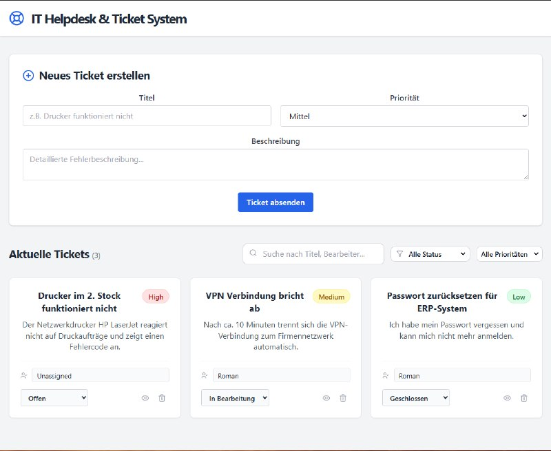
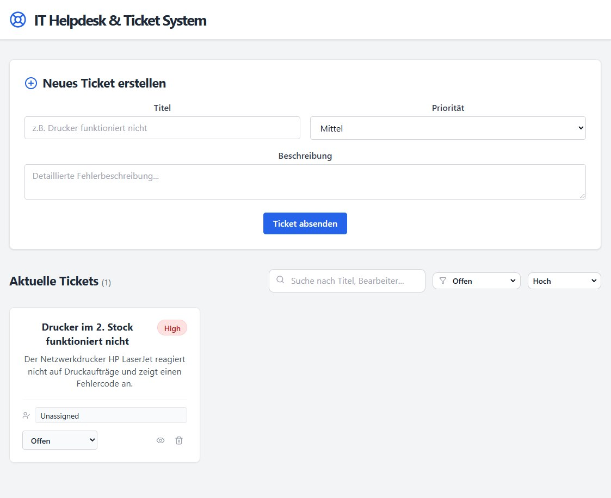
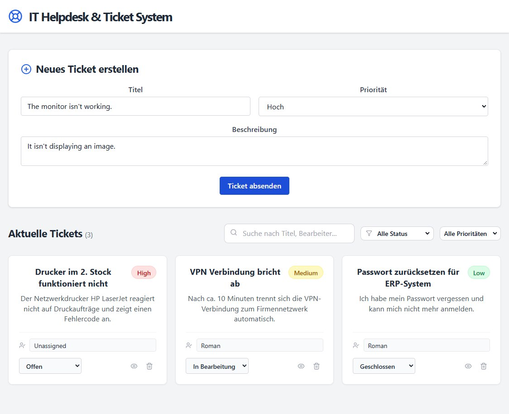
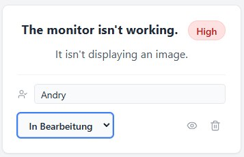
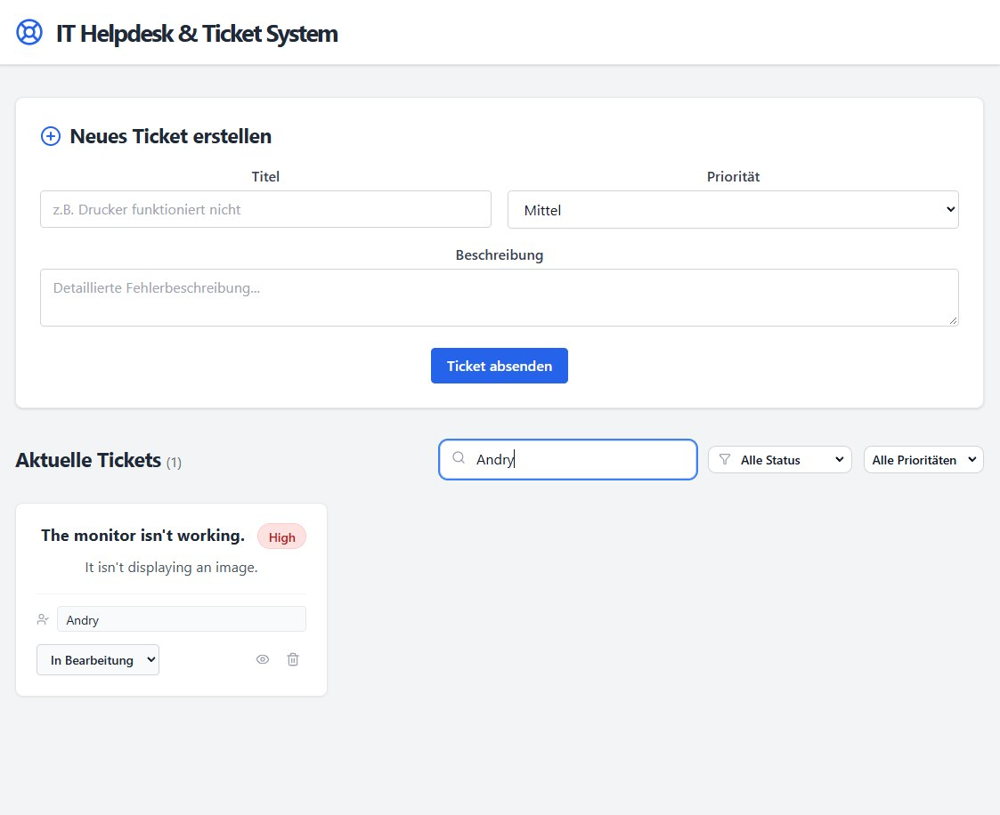
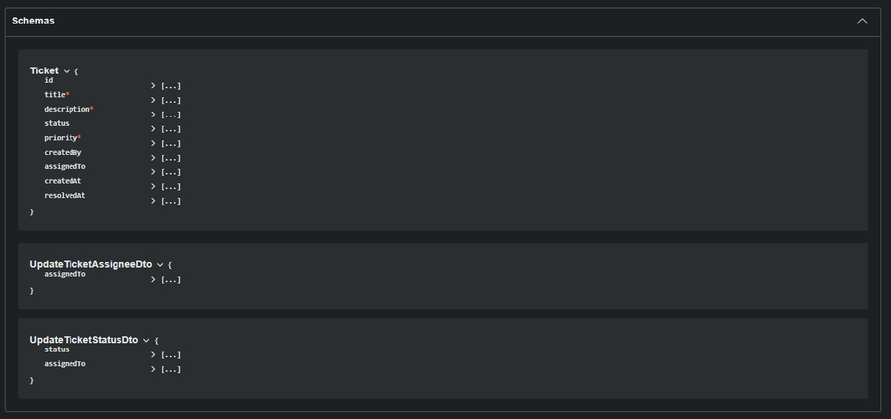
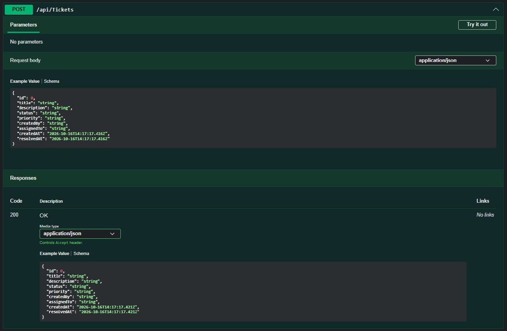

# Mini Helpdesk – Ticket Management API

A containerized IT helpdesk and ticket management application built with **C#, ASP.NET Core 10 Web API, Entity Framework Core, and PostgreSQL**. This project demonstrates REST API development, relational data persistence, request validation, centralized exception handling, structured logging, and containerized deployment with Docker Compose.

## Table of Contents

- [Project Overview](#project-overview)
- [Features](#features)
- [Technology Stack](#technology-stack)
- [Architecture](#architecture)
- [Screenshots](#screenshots)
- [Getting Started](#getting-started)
- [REST API Documentation](#rest-api-documentation)
- [Potential Improvements](#potential-improvements)
- [Repository](#repository)

## Project Overview

Mini Helpdesk is a backend-focused application for managing IT support requests. It provides a REST API that enables clients to create, retrieve, filter, update, assign, and delete support tickets.

Tickets contain information such as a title, description, status, priority, creator, and assigned support employee. The application also supports tracking ticket resolution through a `ResolvedAt` timestamp.

The backend uses Entity Framework Core to interact with a PostgreSQL database. The API exposes its functionality through HTTP and JSON, while Docker Compose coordinates the application and database containers.

### Project Objectives

- Develop a RESTful API using C# and ASP.NET Core 10.
- Organize backend components using a layered structure.
- Implement relational data persistence with Entity Framework Core and PostgreSQL.
- Model common IT support and ticket management workflows.
- Validate incoming data using FluentValidation.
- Handle exceptions through centralized middleware.
- Implement application logging with Serilog.
- Containerize the backend and database using Docker Compose.
- Document and test API endpoints through Swagger UI.

## Features

### Ticket Management

- Create support tickets with a title, description, and priority.
- Retrieve all tickets or a specific ticket by ID.
- Filter tickets by status and priority.
- Update ticket information and status.
- Assign tickets to support employees.
- Delete tickets.
- Track ticket creation and resolution timestamps.

### Validation and Error Handling

- Validate incoming request data before processing.
- Check ticket fields against the configured validation rules.
- Handle application exceptions through centralized middleware.
- Record relevant application events and errors using Serilog.

### Database and Infrastructure

- Persist ticket data in PostgreSQL.
- Access relational data through Entity Framework Core.
- Run the backend and database with Docker Compose.
- Store database data in a persistent Docker volume.
- Explore and test API endpoints using Swagger UI.

## Technology Stack

| Category | Technologies |
|---|---|
| Language | C# |
| Backend | ASP.NET Core 10 Web API |
| Data Access | Entity Framework Core |
| Database | PostgreSQL |
| Validation | FluentValidation |
| Logging | Serilog |
| API Documentation | Swagger / OpenAPI |
| Containerization | Docker, Docker Compose |
| Version Control | Git, GitHub |

## Architecture

The application separates HTTP request handling, data access, validation, and error handling into dedicated components.

- **API Layer:** Controllers handle incoming HTTP requests and return API responses.
- **Data Access:** Entity Framework Core manages database operations.
- **Data Model:** The `Ticket` entity represents support tickets and their properties.
- **Validation:** FluentValidation checks incoming data.
- **Exception Handling:** Custom middleware centralizes exception handling.
- **Logging:** Serilog records relevant application events and errors.
- **Infrastructure:** Docker Compose coordinates the API and PostgreSQL services.

### Project Structure

```text
Helpdesk.Api/
├── Controllers/
│   └── TicketsController.cs
├── Data/
│   └── AppDbContext.cs
├── Models/
│   └── Ticket.cs
├── Validators/
│   └── TicketValidator.cs
├── Middleware/
│   └── ExceptionHandlingMiddleware.cs
├── Dockerfile
├── docker-compose.yml
└── README.md
```

The structure above illustrates the main components. Additional files and directories may be present in the repository.

## Screenshots

The following screenshots demonstrate the application's user interface, ticket management workflow, and REST API documentation.

### 1. Dashboard Overview



The main dashboard displays existing support tickets, filtering controls, and the ticket creation form.

### 2. Create a Support Ticket



The ticket creation form with its title, description, and priority fields configured before submission.

### 3. Ticket Details



A detailed view of a selected ticket, including its metadata, creator, assigned employee, and creation timestamp.

### 4. Ticket Filtering and Search


The interface demonstrates how users can search for relevant support tickets and narrow down the displayed results.

### 5. Empty Search Results



The empty state displayed when the current search or filtering criteria return no matching tickets.

### 6. REST API Overview



Swagger UI provides an overview of the available API endpoints and their HTTP methods.

### 7. Data Transfer Object Schemas



The schema section documents the ticket model and request DTOs used by the API.

### 8. Create Ticket API Request



Swagger UI example for `POST /api/Tickets`, showing the JSON request body and the documented API response.

## Getting Started

### Prerequisites

- [Git](https://git-scm.com/)
- [Docker Desktop](https://www.docker.com/products/docker-desktop/)

### 1. Clone the Repository

```bash
git clone https://github.com/romsches/mini-helpdesk.git
cd mini-helpdesk
```

### 2. Start Docker Desktop

Make sure Docker Desktop is running and the Docker engine is available.

### 3. Build and Start the Application

From the directory containing `docker-compose.yml`, run:

```bash
docker compose up --build -d
```

Docker Compose builds the required images and starts the services defined in the Compose configuration.

### 4. Open Swagger UI

If the API is configured to publish port `5208` on the host, open:

[http://localhost:5208/swagger/index.html](http://localhost:5208/swagger/index.html)

### Stop the Application

```bash
docker compose down
```

This command stops and removes the containers and Compose network. The persistent database volume is not explicitly deleted.

**Note:** Avoid `docker compose down -v` if you want to retain the database volume and its stored data.

## REST API Documentation

The API exposes HTTP endpoints for managing support tickets. Swagger UI documents the available routes, request parameters, schemas, and responses. It also allows requests to be executed directly from the browser.

The API operations include:

| HTTP Method | Purpose |
|---|---|
| `GET` | Retrieve tickets |
| `GET` | Retrieve a ticket by ID |
| `POST` | Create a ticket |
| `PUT` | Update ticket information |
| `PATCH` | Update selected ticket properties, such as status |
| `DELETE` | Delete a ticket |

The exact routes, parameters, request bodies, and response codes depend on the current implementation. Consult Swagger UI for the authoritative API specification.

## Potential Improvements

Possible future enhancements include:

- React and TypeScript frontend.
- JWT-based authentication.
- Role-based authorization for users and support agents.
- Advanced search, filtering, and sorting.
- Unit and integration tests.
- Automated CI/CD pipeline.
- Extended monitoring and application diagnostics.
- Cloud deployment.

These items are potential extensions, not claims about currently implemented functionality.

## Repository

**GitHub:** [github.com/romsches/mini-helpdesk](https://github.com/romsches/mini-helpdesk)

---

*Developed as a portfolio project to demonstrate backend development with C#, ASP.NET Core, Entity Framework Core, PostgreSQL, and Docker.*
